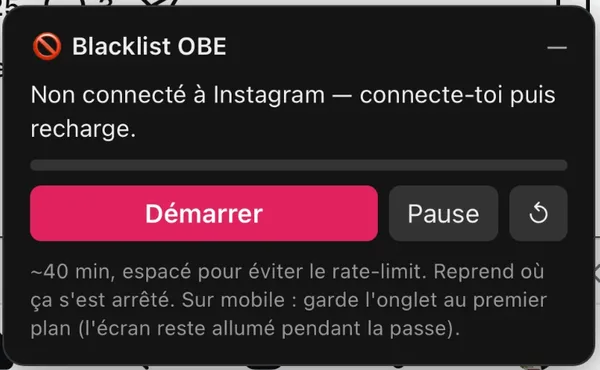

[← Accueil](index.md)

# FAQ et dépannage

Un truc coince ? Pas de stress, la plupart des soucis se règlent en deux minutes.

## Le panneau « Blacklist OBE » n'apparaît pas

Vérifie dans l'ordre :

- Tu es bien sur **www.instagram.com** dans ton navigateur, et pas dans l'appli ?
- **Recharge la page** (touche F5 sur ordi, ou tire l'écran vers le bas sur mobile).
- L'extension (Tampermonkey ou Userscripts) est bien **activée**, et le script **ig-block est activé** dans sa liste ?
- Sur Chrome / Edge : tu as bien activé l'interrupteur **Autoriser les scripts utilisateur** ? ([voir le guide](ordinateur.md#chrome-edge-brave-opera))
- Sur iPhone ou Safari Mac : Userscripts a bien le droit d'agir sur instagram.com ? Et dans **☰ → Userscripts**, le nom du script n'est pas grisé ? (grisé = désactivé, appuie dessus pour le réactiver)

## Le panneau dit « Non connecté à Instagram »

Connecte-toi à Instagram **dans ce navigateur-là**, puis recharge la page.
Être connecté·e dans l'appli ne compte pas : pour le navigateur, c'est comme si c'était un autre appareil.

**Tu es pourtant bien connecté·e (tu vois ton fil) ?** Recharge simplement
la page : le panneau a parfois besoin que la page soit complètement chargée
pour voir que tu es connecté·e.

## Le panneau dit « Rate limit — pause 10 min »

C'est normal ! Instagram demande de lever le pied. Le script attend tout seul
10 minutes et repart. Laisse juste la page ouverte.

## Instagram affiche « Action bloquée » / « Réessayez plus tard »

Instagram a trouvé que tu bloquais beaucoup de monde et t'a mis en pause
temporairement. Ce n'est **pas** une sanction définitive, ton compte va bien.

1. Clique sur **Pause** (ou ferme la page).
2. Attends **quelques heures** (le plus tranquille, c'est d'attendre le lendemain).
3. Reviens sur instagram.com et clique sur **Démarrer** : le script reprend où il s'était arrêté.

## Le panneau dit « Trop d'erreurs, arrêt »

Le script a préféré s'arrêter par prudence. Attends un peu, recharge la page
et clique sur **Démarrer**. Si ça recommence, laisse passer quelques heures.

## Ma liste « Comptes bloqués » n'affiche presque rien

C'est juste qu'Instagram ne met pas cette page à jour toute seule : elle
montre la liste telle qu'elle était quand tu l'as ouverte. **Actualise la page**
(la flèche ↻ à côté de l'adresse) et tous les comptes bloqués par le script
apparaissent.

Pour vérifier un compte en particulier, ouvre son profil : s'il est bloqué,
tu vois un bouton **Débloquer** à la place de « Suivre ».

## Certains comptes ne sont pas bloqués

Le cas le plus courant : le compte **t'a déjà bloqué·e**. Du coup, Instagram
te le cache, et le script ne peut pas le trouver. Bon… le résultat est le
même, vous ne vous voyez plus. 😉

Ça peut aussi être un compte qui a changé de nom ou qui a été supprimé.

## J'ai fermé la page avant la fin

Aucun souci. Reviens sur instagram.com **avec le même navigateur** et clique
sur **Démarrer** : ta progression est sauvegardée.

## J'ai plusieurs comptes Instagram

Connecte-toi à ton autre compte sur instagram.com et relance. Le script garde
une progression séparée pour chaque compte, il ne mélange rien.

## La liste a été mise à jour, comment bloquer les nouveaux ?

Reviens sur instagram.com et clique sur **Démarrer**. Le script va chercher la
liste à jour et ne s'occupe que des comptes pas encore bloqués.

## Comment débloquer un compte ?

Dans l'appli Instagram : **Profil → menu ☰ → Bloqués** (ou **Paramètres et
confidentialité → Comptes bloqués**), puis **Débloquer** à côté du compte.

## C'est vraiment sans risque pour mon compte ?

Soyons honnêtes :

- Le script tourne **dans ton navigateur**, exactement comme si tu cliquais toi-même. Il ne connaît pas ton mot de passe et n'envoie tes infos à personne.
- Son code est **public** : tout le monde peut vérifier ce qu'il fait.
- Il bloque lentement (un compte toutes les 25 à 50 secondes) pour ressembler à quelqu'un de normal.
- Par contre, Instagram interdit officiellement ce genre d'outil. Le risque réaliste, c'est une limitation temporaire (voir « Action bloquée » plus haut). Mais ça reste sous ta responsabilité.

## Comment être sûr·e d'avoir le vrai script ?

Installe-le **uniquement** depuis le lien des guides, qui commence par
`https://raw.githubusercontent.com/Lets-Fork-The-System/ig-block/`. Si quelqu'un t'envoie
« sa version » en message privé ou un lien vers un autre site, ne l'installe
pas : un faux script pourrait faire n'importe quoi avec ton compte.

Une fois installé, le script se met à jour tout seul depuis ce repo officiel,
tu n'as rien à faire.

## Comment je désinstalle ?

- **Juste le script :** ouvre le tableau de bord de Tampermonkey (ou l'appli Userscripts) et supprime « On bloque l'extrême droite ».
- **Tout :** désinstalle Tampermonkey / Userscripts comme n'importe quelle extension ou appli.

Les comptes déjà bloqués restent bloqués, évidemment.

## Mon problème n'est pas dans la liste

Ouvre un ticket sur [GitHub](https://github.com/Lets-Fork-The-System/ig-block/issues) en
expliquant ton appareil, ton navigateur, et ce qu'affiche le panneau. Une
capture d'écran aide énormément (tu peux masquer ton pseudo si tu préfères).
