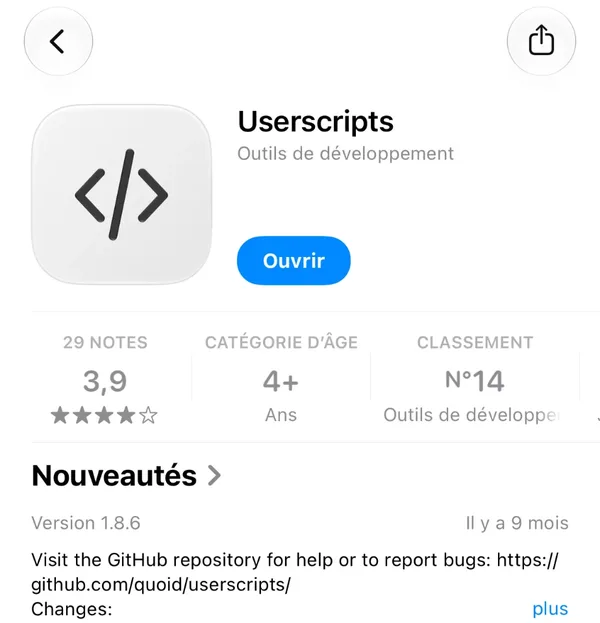
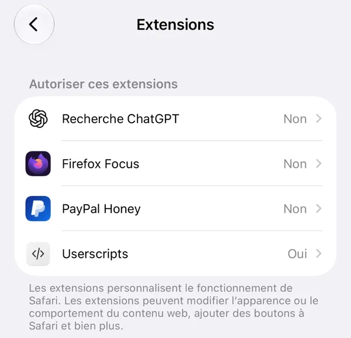
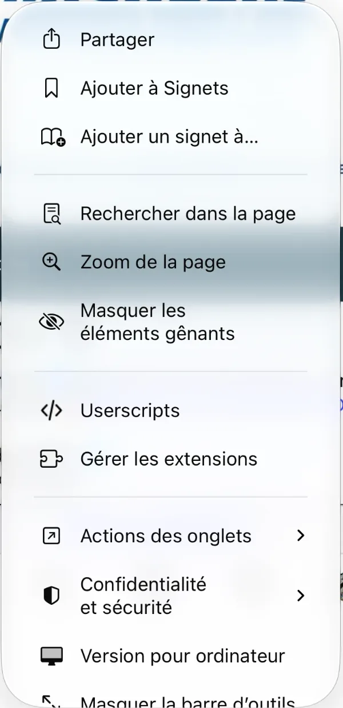
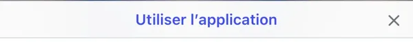
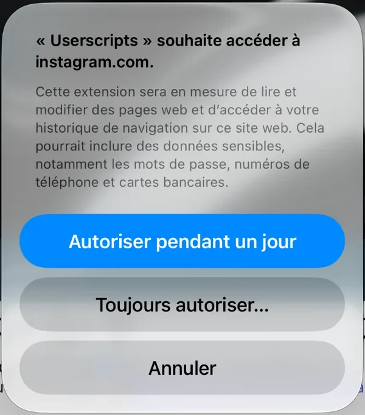
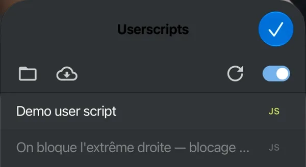

[← Accueil](index.md)

# Sur iPhone ou iPad

Compte 5 à 10 minutes d'installation, puis une quarantaine de minutes avec l'écran allumé.

> ⚠️ **Petit piège : l'appli Instagram ne suffit pas.** Les applis ne
> peuvent pas faire tourner de scripts, il faut passer par **Safari** avec
> l'extension gratuite **Userscripts**. Mais rassure-toi : une fois les comptes
> bloqués, ils le sont aussi dans l'appli.

## Étape 1 : installe Userscripts

Userscripts, c'est l'extension qui va faire tourner le script dans Safari.

1. Ouvre l'**App Store** et cherche **Userscripts**, ou ouvre directement [ce lien](https://apps.apple.com/app/userscripts/id1463298887).
   C'est celle avec l'icône `</>` sur fond blanc, rangée dans « Outils de développement ».
2. Appuie sur **Obtenir**.
3. Ouvre l'appli **Userscripts** une fois. Si elle te demande de choisir un dossier, prends celui qu'elle propose.

## Étape 2 : active l'extension dans Safari

Sur iPhone, les extensions Safari s'activent dans les Réglages, pas dans Safari lui-même.

1. Ouvre l'appli **Réglages**.
2. Va dans **Apps → Safari → Extensions** (sur les iPhone un peu plus anciens : **Safari → Extensions**).
3. Appuie sur **Userscripts** et active **Autoriser l'extension**.
4. Reviens en arrière : en face de **Userscripts**, tu dois voir **Oui**.

## Étape 3 : installe le script ig-block

1. **Dans Safari**, ouvre ce lien : **[Installer ig-block](https://raw.githubusercontent.com/Lets-Fork-The-System/ig-block/stable/ig-blacklist.user.js)**
   Une page remplie de code s'affiche : t'inquiète, c'est normal, c'est le script.
2. Appuie sur l'icône **☰** à gauche de l'adresse, en bas de l'écran. Un menu s'ouvre : appuie sur **Userscripts**.

   

3. Si Safari te demande si Userscripts peut accéder au site, appuie sur **Toujours autoriser…** (on en reparle juste en dessous).
4. Appuie sur **Installer** / **Install**.

## Étape 4 : connecte-toi à Instagram dans Safari

1. Dans Safari, va sur **[www.instagram.com](https://www.instagram.com)**.
2. Instagram va te pousser à **utiliser l'appli** avec un bandeau en bas de l'écran : ignore-le ou ferme-le avec la **✕**. Reste dans Safari.

   

3. Connecte-toi avec ton identifiant et ton mot de passe.
4. Safari affiche **« Userscripts » souhaite accéder à instagram.com** : appuie sur **Toujours autoriser…**.

   

   Pourquoi pas « Autoriser pendant un jour » ? Ça marche aussi, mais le blocage dure 40 minutes et tu devras peut-être revenir le lendemain : avec « Toujours », tu n'auras pas à re-valider. Le message parle de mots de passe et de cartes bancaires parce qu'iOS l'affiche pour **toutes** les extensions : ig-block, lui, ne lit rien de tout ça (son code est public).

5. Pour vérifier que tout est en place : menu **☰ → Userscripts**. Tu dois voir « On bloque l'extrême droite » dans la liste.

   

   Si son nom est **grisé**, il est désactivé : appuie dessus pour le réactiver, puis recharge la page.

## Étape 5 : lance le blocage

1. Un panneau noir **« 🚫 Blacklist OBE »** apparaît en bas à droite de la page. Il n'est pas là ? Recharge la page (la flèche ↻ à droite de l'adresse).
2. Attends qu'il affiche un truc du genre « 63 comptes à bloquer ». S'il dit « Non connecté à Instagram », va voir [la FAQ](faq.md).
3. Appuie sur **Démarrer**, puis **OK** pour confirmer.
4. **Garde Safari ouvert, au premier plan, sur cet onglet.** Le script essaie de garder l'écran allumé (ça marche à partir d'iOS 16.4).
   - Mets ton iPhone en charge, ce sera plus tranquille.
   - L'écran se verrouille quand même ? Va dans **Réglages → Luminosité et affichage → Verrouillage automatique → Jamais**, le temps que ça tourne. Pense à remettre le réglage après !
   - Si tu passes sur une autre appli, le script se met en pause (iOS endort les pages qu'on ne regarde pas). Pas grave : il repart quand tu reviens sur Safari. Au besoin, réappuie sur **Démarrer**.
5. Au bout d'une quarantaine de minutes, le panneau affiche **« ✅ Terminé »**.

Et voilà ! 🎉

> **Tu as déjà Tampermonkey sur ton iPhone ?** (version payante) Ça marche
> aussi : même principe, tu actives l'extension dans les Réglages de Safari,
> puis tu ouvres le lien d'installation.

Un pépin ? → [FAQ et dépannage](faq.md)
